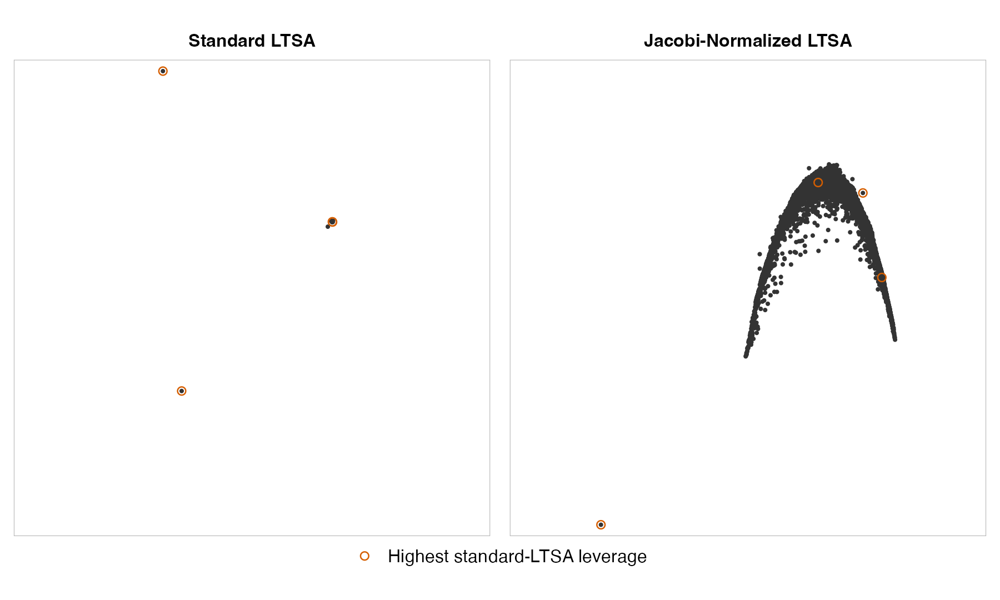
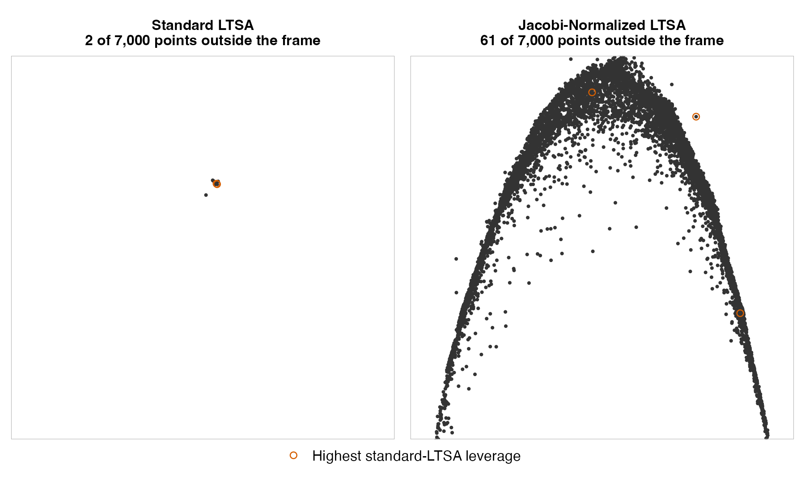
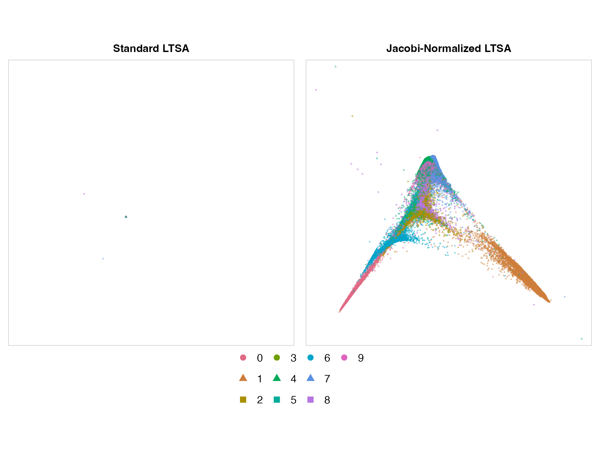
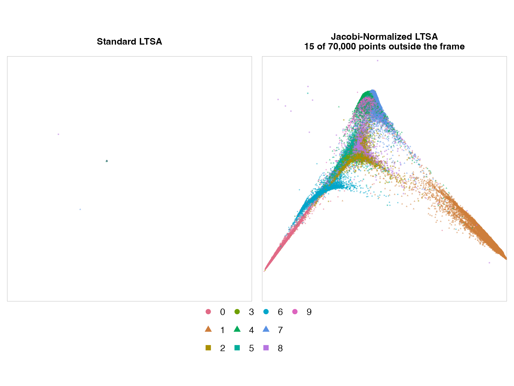
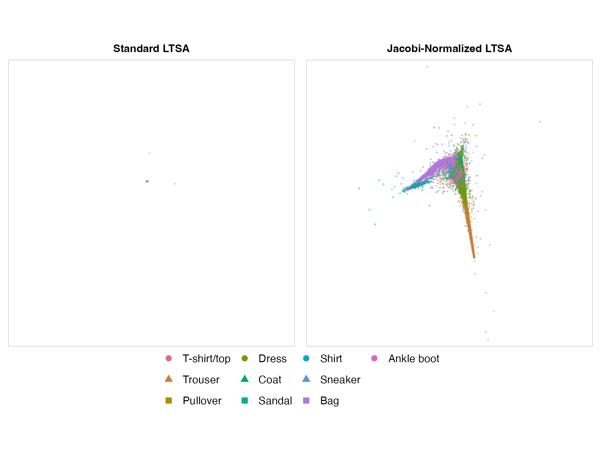
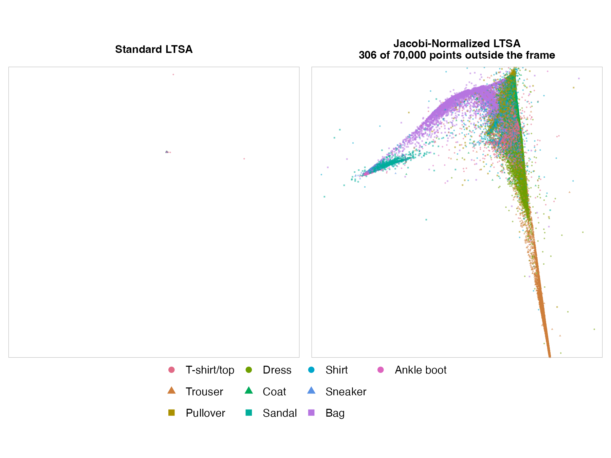
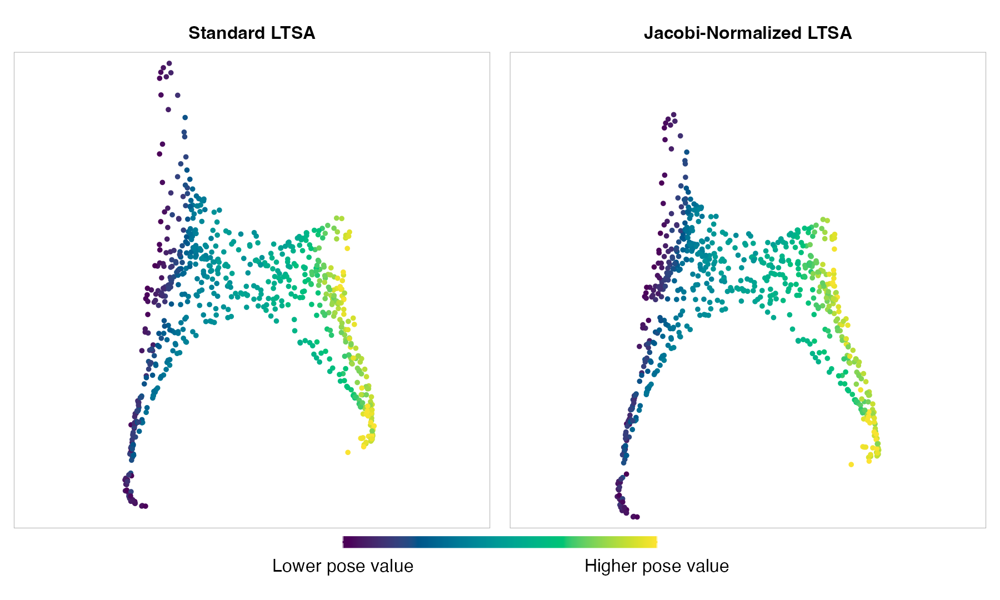
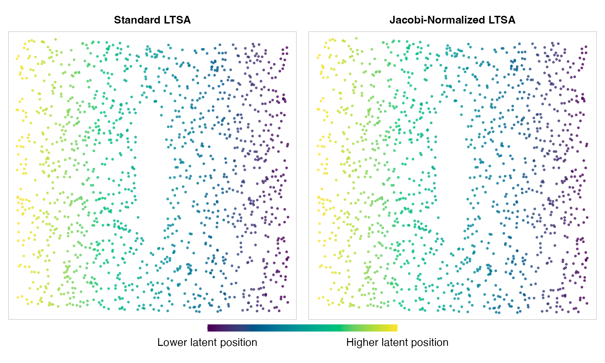
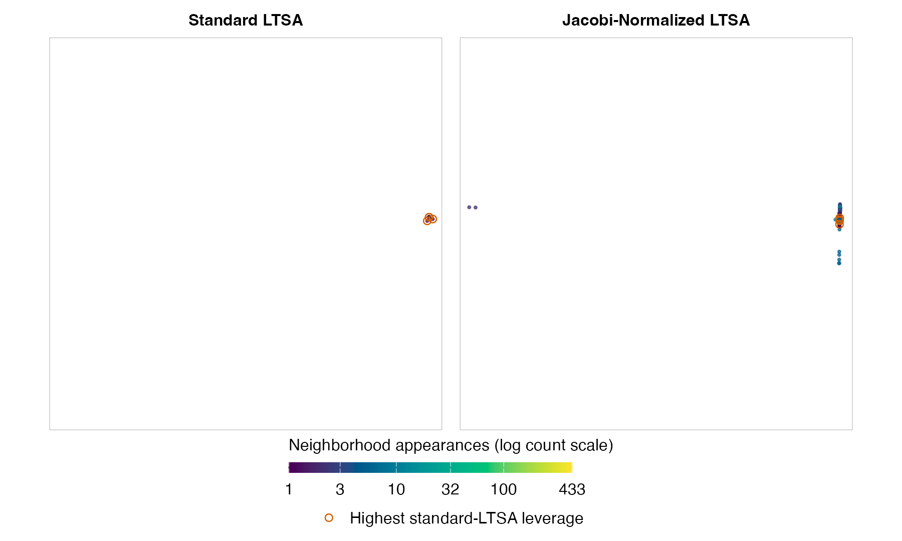

The [LTSA article](LTSA.html) gave us a recipe: construct local charts, assemble their alignment
matrix $B$, and use eigenvectors to find global coordinates that agree with those charts. Along
the way, we chose a normalization to keep the embedding from collapsing. Changing that choice
gives us a way to explore a family of LTSA methods while retaining much of the same implementation.

The idea is to measure the length and orthogonality of the global coordinate columns using a
matrix $D$. We keep the neighborhoods, local PCA calculations, and alignment matrix $B$. The new
constraint leads to a generalized eigenvalue problem. The trick is to change variables so that
we can solve an ordinary symmetric eigenvalue problem using the existing LTSA eigensolver, then
convert its eigenvectors back to the coordinates we want.

The choice of $D$ makes this practical. For a diagonal $D$, the conversion requires only
rescaling: the transformed alignment matrix has the same sparsity pattern as $B$. We also need
to adjust the direction excluded for centering. Different valid weights give us a family of
normalizations without having to replace the rest of the LTSA machinery.

This leaves us with two questions:

- **What should $D$ represent?** We want the new inner product to reflect something relevant
  to the embedding: perhaps neighborhood participation, local alignment costs, or a property
  measured across the whole dataset. Valid choices of $D$ can give different coordinates; we
  need a reason to prefer one choice to another.
- **Can we use $D$ efficiently?** Constructing and storing it must be affordable, as must the
  transformation of $B$ and the conversion back to coordinates. In particular, we would like
  to retain the sparse computations that make LTSA practical for larger datasets.

A diagonal $D$ is an attractive starting point: it stores one weight per observation, and the
transformations amount to rescaling. This article explores **Jacobi normalization**, which takes
those weights from the diagonal of $B$ itself. That gives us a choice tied to the local alignment
problem, using quantities we have already computed. Let's work through the change of constraints
and the eigenvector calculation, then see what these weights do to some embeddings.

## The Normalization Constraint {#where-the-choice-enters}

As before, let $Y$ be an $N \times d$ matrix of global coordinates, with one observation per row.
After fitting an affine transformation from each local chart to its corresponding rows of $Y$,
the total squared alignment error is

$$
E(Y)=\operatorname{tr}(Y^{\mathsf T}BY).
$$

We use exactly the same affine fits and cost as in the LTSA article. In particular, $B$ is still
symmetric and positive semidefinite, and $B\mathbf{1}_N=0$: translating the whole embedding
leaves the cost unchanged.

The next step in standard LTSA was to require

$$
Y^{\mathsf T}Y=I_d,\qquad Y^{\mathsf T}\mathbf{1}_N=0.
$$

These conditions make the coordinate columns orthonormal and centered. The affine-fitting
argument did not require this particular normalization. In section 4 of
[the LTSA paper](https://arxiv.org/abs/cs/0212008), Zhang and Zha point out:

> there are more than one way to impose the normalization conditions. The one we have selected
> [...] is just one of the possibilities.

We can choose a different normalization while keeping $E(Y)$ as our objective.

## A Different Inner Product {#choosing-a-different-length}

Give each observation a finite positive weight $d_j$, and put these weights on the diagonal of an
$N \times N$ matrix $D$. For one coordinate column $y$, replace the usual squared length
$y^{\mathsf T}y$ with a weighted squared length:

$$
y^{\mathsf T}Dy=\sum_{j=1}^N d_j y_j^2.
$$

Because every weight is positive, this length is positive for every nonzero coordinate column.
We choose the weights before optimizing $Y$ and keep them fixed during the optimization. If
every weight is one, $D=I_N$ and we recover standard LTSA.

The corresponding inner product of two coordinate columns $y$ and $v$ is $y^{\mathsf T}Dv$.
Using it for orthogonality and centering gives us the modified problem:

$$
\begin{gathered}
\min_Y\,\operatorname{tr}(Y^{\mathsf T}BY) \\
\begin{aligned}
\text{subject to}\quad Y^{\mathsf T}DY&=I_d, \\
Y^{\mathsf T}D\mathbf{1}_N&=0.
\end{aligned}
\end{gathered}
$$

The first constraint still prevents zero-length or repeated axes. The second makes each
coordinate column orthogonal to the constant vector in the new inner product. For diagonal
$D$, it says that each column has weighted mean zero:

$$
\frac{\sum_j d_j y_j}{\sum_j d_j}=0.
$$

This changes the **global** centering condition. Local PCA and the affine fits still use ordinary
neighborhood means. Global centering chooses an origin for the whole embedding, and subtracting
the weighted mean leaves the alignment cost unchanged because $B\mathbf{1}_N=0$.

The cost assigned to any particular $Y$ is unchanged, but the set of allowed $Y$ matrices has
changed. Consequently, the best embedding can change too. In general, solving this new problem
cannot be replaced by rescaling or applying a global affine transformation to the standard
LTSA result.

## The Generalized Eigenvalue Problem {#why-eigenvectors-still-solve-it}

For one coordinate column $y$, minimizing the cost with the weighted unit-length constraint
leads to the following equation for a candidate solution:

$$
By=\lambda Dy.
$$

This is a **generalized eigenvalue problem**. Multiplying the equation by $y^{\mathsf T}$ shows
that $\lambda$ is the alignment cost divided by the weighted squared length. Under the unit-length
constraint, it is exactly the alignment cost. We therefore want the lowest-cost eigenvectors,
excluding the constant direction and keeping the coordinates orthogonal in the weighted inner
product.

We could use a generalized eigensolver, but we already have machinery for ordinary symmetric
eigenproblems. Let's change variables so we can use it here, and see why that also gives us the
minimum rather than just a candidate solution.

## Transforming the Eigenproblem {#transforming-the-matrix}

Here is the trick: temporarily rescale each observation's coordinate value by the square root of
its weight. We can then solve an ordinary eigenproblem and rescale the result back. Since $D$ is
diagonal with positive entries, $D^{1/2}$ has entries $d_j^{1/2}$ and is invertible. Set

$$
z=D^{1/2}y,\qquad y=D^{-1/2}z.
$$

Then the cost and the length become

$$
\begin{aligned}
y^{\mathsf T}By&=z^{\mathsf T}B_{\mathrm{sym}}z, \\
y^{\mathsf T}Dy&=z^{\mathsf T}z, \\
B_{\mathrm{sym}}&=D^{-1/2}BD^{-1/2}.
\end{aligned}
$$

So the two factors of $D^{-1/2}$ come from substituting for $y$ on both sides of the quadratic
cost. $B_{\mathrm{sym}}$ is symmetric, and it is positive semidefinite because its quadratic
cost is the original nonnegative cost expressed in the new variables. We therefore have the
same kind of minimization as in standard LTSA: minimize a symmetric quadratic cost with
Euclidean unit-length and orthogonality constraints.

The eigenvector equation transforms along with them:

$$
B_{\mathrm{sym}}z=\lambda z
\quad\Longleftrightarrow\quad
By=\lambda Dy.
$$

If you've seen [Laplacian Eigenmaps](https://jlmelville.github.io/smallvis/spectral.html#Laplacian_Eigenmaps),
this may look familiar. There, the same rescaling connects a generalized eigenvalue problem to an
ordinary symmetric one. Here, $B$ is LTSA's alignment matrix, and $D$ contains our chosen
observation weights; in Laplacian Eigenmaps, the corresponding matrices are the graph Laplacian
and the degree matrix.

We still need to enforce centering when choosing the eigenvectors. As in standard LTSA, the
constant direction has zero alignment cost and must be excluded. In the new variables, it becomes

$$
q=D^{1/2}\mathbf{1}_N,\qquad B_{\mathrm{sym}}q=0.
$$

Choosing eigenvectors orthogonal to $q$ enforces our weighted centering constraint, because

$$
z^{\mathsf T}q=y^{\mathsf T}D\mathbf{1}_N.
$$

For all $d$ columns at once, write $Z=D^{1/2}Y$. The transformed coordinates have ordinary
unit lengths, are orthogonal to each other, and are orthogonal to $q$. We can therefore take
the $d$ orthonormal eigenvectors of $B_{\mathrm{sym}}$ with the lowest eigenvalues in the space
orthogonal to $q$. This gives the global minimum for the transformed problem, and hence for our
weighted problem. Recover the desired coordinates with $Y=D^{-1/2}Z$.

The returned columns of $Y$ have unit length and are orthogonal and centered in the $D$ inner
product; they need not have those properties in the ordinary Euclidean sense.

The direction to exclude is now $q$, which is generally **not** a constant vector. The
[procedure for handling other zero modes](LTSA.html#other-zero-modes) carries over too: `flotsam`
projects $q$ out of the candidate vectors before selecting the coordinates. The invertible
change of variables preserves the number of zero modes.

This transformation gives an equivalent ordinary eigenproblem for our **new** weighted problem.
It does not preserve the ordinary eigenvalues or eigenvectors of $B$. Both the eigenvalues and
the selected coordinate directions can change when we change $D$.

## Jacobi Normalization {#choosing-the-weights}

We can now return to the two questions from the introduction. A diagonal $D$ meets the
computational requirement particularly well: we store just $N$ weights, rescale the existing
nonzero entries of $B$, and recover $Y$ by rescaling the rows of $Z$. These steps add work, and
the eigensolver may take a different amount of time, but no dense alignment matrix or different
eigensolver is needed. Other positive-definite choices of $D$ are possible; for a non-diagonal
$D$, sparsity alone is not enough to guarantee that its factors or the transformed matrix stay
sparse.

For the meaning of those weights, the choice used by `flotsam` is the diagonal of $B$:

$$
D=\operatorname{diag}(B),\qquad d_j=B_{jj}.
$$

This is **Jacobi normalization**. Every diagonal entry of $B_{\mathrm{sym}}$ is then one, since
$B_{jj}/d_j=1$. It requires every $B_{jj}$ to be strictly positive. Positive
semidefiniteness of $B$ guarantees only nonnegative diagonal entries, so this is an additional
requirement. `flotsam` rejects normalization if an entry is nonpositive or nonfinite.

$B_{jj}$ is the alignment cost of giving observation $j$ the value one and all other observations
the value zero. So this uses the alignment cost of an isolated spike at observation $j$ as that
observation's normalization weight.

The weighted squared length therefore uses each observation's individual spike cost. A coordinate gains
no special advantage merely because it concentrates on an observation that is individually cheap
to move. We'll return to this after looking at an example.

Two things contribute to $B_{jj}$: the number of neighborhoods containing observation $j$, which
is related to its hubness, and the average residual cost of that spike within those neighborhoods.
The latter depends on how well each neighborhood's local tangent coordinates, together with a
constant term, can represent the spike.

So these weights reflect both neighborhood participation and the local fits, while adding only
row and column scaling to the matrix calculation. That gives us a reason to try them. Whether
the resulting coordinates are more useful for a particular dataset remains an empirical
question. Let's look at some examples.

## Comparing the Embeddings {#trying-the-normalization}

```{r setup, include=FALSE}
knitr::opts_chunk$set(collapse = TRUE, comment = "#>", fig.align = "center")
```

Standard LTSA can put almost every observation in a tiny clump, with a few
points setting the scale of the whole picture. **Jacobi normalization** changes
how the coordinates distribute their variation over the observations. In some
datasets, it gives many more points a visible role. To use it with a data matrix `X`:

```{r use-normalization, eval=FALSE}
flotsam::ltsa(X, normalize = TRUE)
```

## Fashion-MNIST Ankle Boots {#a-plot-carried-by-a-few-observations}

These are two fits of the same 7,000 Fashion-MNIST ankle-boot images. Each
comparison in this article uses the same approximate Euclidean neighbor graph
for both fits: 15 observations per neighborhood, including the observation
itself, with a local tangent dimension of two. Standard LTSA
concentrates most images in a small clump. With Jacobi normalization, the
images occupy a broad curved band. Both panels show the full coordinate range.
Click a figure to enlarge it.

```{r fashion, echo=FALSE, out.width="100%", fig.alt="Two scatterplots of all Fashion-MNIST ankle boots. Standard LTSA compresses nearly all points into a clump; Jacobi-normalized LTSA spreads the images into a curved band. Orange rings identify the same influential observations in both panels."}

```

Orange rings track the same four images in both panels. They have the largest
leverage scores: they contribute unusually strongly to the subspace spanned by
the first twelve standard-LTSA coordinates. Only the first two coordinates are
shown, so an image's contribution need not be obvious in this view.
The standard fit is aligned to the normalized fit by translation, rotation or
reflection, and a uniform scale.
The same alignment is used for the other comparisons.

<details>
<summary>Zoom In on the Ankle-Boot Embeddings</summary>

This view uses a square window based on the 1st and 99th percentiles of each
normalized coordinate. Where images fall outside the window, the panel title
reports the count.

```{r fashion-zoom, echo=FALSE, out.width="100%", fig.alt="A closer view of the ankle-boot embeddings, showing the normalized curved band and the standard fit's central clump. Counts indicate images outside the frame."}

```

</details>

## Why Small Diagonal Entries Matter

When the local fits cannot be aligned exactly, LTSA must distribute a fixed amount of
variation across the observations while keeping the cost small.

The diagonal entry $B_{jj}$ has a concrete interpretation. If observation $j$
is assigned the value one and all others zero, the cost is exactly $B_{jj}$.
A small diagonal entry therefore makes a coordinate concentrated on that
observation cheap. Centering it leaves the alignment cost unchanged.
Standard LTSA can consequently put almost all the variation on one or two
observations.

For the same spike under Jacobi normalization, the small diagonal entry affects both the
cost and the weighted squared size. A small absolute weight alone no longer makes it cheap.
This often spreads the variation over more observations. Jacobi normalization
is a different way to satisfy LTSA's normalization constraint, not a
fundamentally better solution to the alignment problem.

## The Complete MNIST Datasets {#the-complete-datasets}

The ankle boots show what can happen within one class. Does normalization
make a visible difference when all the classes are included?

Here are fits of all **70,000 MNIST digits** and all **70,000 Fashion-MNIST
images**, combining the training and test sets. No observations are sampled or
filtered by class. The inputs are the original pixel values, with constant
pixels removed. Class labels are used only to color and mark the plots.

The full-range panels share a frame and show every point. Alignment makes
corresponding shapes easier to compare, but its fitted scale can make a poorly
matching standard fit look especially small. Expand the zooms to inspect the
central region. The windows are based on the 1st and 99th percentiles of each
normalized coordinate; a panel title reports the count if points fall outside.
The standard fits have closely spaced modes at the boundary of the selected
two-dimensional subspace, so the views may be sensitive to numerical or graph
changes.

### MNIST

Standard LTSA again puts almost all the variation on a couple of observations,
leaving the rest of the digits in a tiny clump. Normalization produces a broad,
branched shape. Zeros and ones occupy different arms, but many of the other
digits still overlap: this is a visible change without a clean separation
into ten groups.

```{r mnist-full-range, echo=FALSE, out.width="100%", fig.alt="The full MNIST coordinate range, colored by digit. Standard LTSA is dominated by a few observations, while the normalized fit spreads digits over a branched shape with some outliers."}

```

<details>
<summary>MNIST: Zoom Into the Central Region</summary>

```{r mnist-zoom, echo=FALSE, out.width="100%", fig.alt="A closer view of MNIST: normalized coordinates form a branched shape, with zeros and ones on different arms and several digits overlapping. Counts indicate points outside the frame."}

```

</details>

### Fashion-MNIST

The change also survives putting the ankle boots back among the other clothes.
Bags occupy a curved branch of the normalized plot, and trousers extend along
a long, thin arm. Several clothing classes still overlap heavily, but we can
see class-related structure that is hidden in the standard fit's clump.

```{r fashion-full-range, echo=FALSE, out.width="100%", fig.alt="The full Fashion-MNIST coordinate range, colored by clothing class. The standard fit concentrates most images in a clump; normalization spreads images across branches with outliers."}

```

<details>
<summary>Fashion-MNIST: Zoom Into the Central Region</summary>

```{r fashion-full-zoom, echo=FALSE, out.width="100%", fig.alt="A closer view of Fashion-MNIST shows a curved branch of bags and a long arm of trousers, with other classes overlapping. Counts indicate points outside the frame."}

```

</details>

## When Normalization Helps Less {#when-the-change-helps-less}

### Isomap Faces

The [Isomap face dataset](https://doi.org/10.1126/science.290.5500.2319)
contains 698 images of a single face with different poses and lighting. Using
the complete dataset, both fits give similar broad shapes, with a smooth
progression in the supplied pose value. Here normalization makes little visible
difference. The pose values are used only to color the points.

```{r isomap-faces, echo=FALSE, out.width="100%", fig.alt="Full-range scatterplots of the Isomap faces, colored by pose. Both fits show similarly shaped clouds with a smooth color progression from one side to the other."}

```

### S-Curve with a Hole {#an-s-curve-with-a-hole-that-already-works}

Both fits unfold this three-dimensional S-shaped surface into a flat sheet,
preserving its hole and the order of points along the curve. Normalization
leaves the arrangement almost unchanged.

```{r s-curve-hole, echo=FALSE, out.width="100%", fig.alt="Two nearly identical rectangular scatterplots with a central hole. Standard and Jacobi-normalized LTSA both unfold the S-shaped surface, with a smooth color gradient across each sheet."}

```

Color follows position along the original S-curve. The panels are aligned
as before, with every point shown.

### CIFAR-10 Airplanes {#cifar-10-airplanes-remain-difficult}

Normalization changes the shape of this collection of airplane images,
but neither view gives us a useful map of their variation. Spreading out
more observations is not enough to make a good visualization. Color shows how
often each image appears in the input neighborhoods; orange rings mark the four
images with the largest leverage scores in the standard-LTSA coordinate subspace,
as in the ankle-boot example.

```{r cifar, echo=FALSE, out.width="100%", fig.alt="Full-range CIFAR airplane plots: both fits concentrate most images in a small region, while the normalized fit also has a few distant outliers."}

```

## Trying It Yourself

Here's how to compare the two fits and make a chart like the full-range
MNIST and Fashion-MNIST figures above. Install or update these packages;
the plotting code uses `vizier` 0.6.2 or later:

```{r install-example, eval=FALSE}
install.packages("pak")
pak::pak(c(
  "jlmelville/flotsam", "jlmelville/snedata", "jlmelville/vizier",
  "ggplot2"
))
```

First choose a dataset. For all 70,000 Fashion-MNIST images:

```{r fashion-input, eval=FALSE}
images <- snedata::download_fashion_mnist(as = "list")
labels <- images$meta$description
```

For all 70,000 MNIST digits, replace those two lines with:

```{r mnist-input, eval=FALSE}
images <- snedata::download_mnist(as = "list")
labels <- images$meta$label
```

The rest of the code works with either dataset. Remove constant pixels and
make one neighbor graph for both fits. Each neighborhood contains the image
itself and fourteen other images; sorting equal distances by row index makes
the selection consistent when there are ties.

```{r compare-fits, eval=FALSE}
X <- images$data
keep <- apply(X, 2, function(column) min(column) != max(column))
X <- X[, keep, drop = FALSE]

set.seed(20260825)
nn <- rnndescent::nnd_knn(X, k = 16, n_threads = 1)
graph <- t(vapply(
  seq_len(nrow(X)),
  function(i) {
    neighbors <- nn$idx[i, order(nn$dist[i, ], nn$idx[i, ])]
    c(i, head(neighbors[neighbors != i], 14))
  },
  integer(15)
))

set.seed(20260825)
standard <- flotsam::ltsa(
  X,
  nn_method = graph,
  ndim = 2,
  spectral_dim = 2,
  eig_method = "rspectra",
  eig_k = 8,
  normalize = FALSE
)
set.seed(20260825)
normalized <- flotsam::ltsa(
  X,
  nn_method = graph,
  ndim = 2,
  spectral_dim = 2,
  eig_method = "rspectra",
  eig_k = 8,
  normalize = TRUE
)
```

Before plotting, align the standard fit to the normalized fit. This helper
centers the two embeddings, finds a rotation or reflection, and fits a uniform
scale. It preserves the shape of each embedding.

```{r comparison-chart, eval=FALSE}
align_to <- function(points, reference) {
  centered <- scale(points, center = TRUE, scale = FALSE)
  target <- scale(reference, center = TRUE, scale = FALSE)
  fit <- svd(crossprod(centered, target))
  rotated <- centered %*% fit$u %*% t(fit$v)
  size <- sum(rotated * target) / sum(rotated^2)
  sweep(size * rotated, 2, colMeans(reference), "+")
}

set.seed(20260825)
rows <- sample.int(nrow(X))
coordinates <- rbind(align_to(standard, normalized)[rows, ], normalized[rows, ])
p <- vizier::embed_ggplot(
  coordinates,
  rep(labels[rows], 2),
  color_scheme = grDevices::hcl.colors(nlevels(labels), "Dark 3"),
  fixed_aspect = TRUE,
  show_axes = FALSE,
  cex = 0.4,
  alpha_scale = 0.55
)
methods <- c("Standard LTSA", "Jacobi-Normalized LTSA")
p$data$method <- factor(rep(methods, each = nrow(X)), levels = methods)
p +
  ggplot2::aes(shape = color) +
  ggplot2::scale_shape_manual(
    values = rep(c(16, 17, 15), length.out = nlevels(labels))
  ) +
  ggplot2::facet_wrap(~method, nrow = 1) +
  ggplot2::labs(color = NULL, shape = NULL) +
  ggplot2::theme(legend.position = "bottom") +
  ggplot2::guides(
    color = ggplot2::guide_legend(nrow = 3, override.aes = list(size = 3)),
    shape = ggplot2::guide_legend(nrow = 3)
  )
```

The facets share coordinate limits and class colors, with equal physical
units on both axes. Every point is shown. Shuffling the rows keeps later
classes from systematically covering earlier ones.

The complete-dataset examples use the two retained spectral coordinates shown
here. For the ankle-boot, S-curve and CIFAR examples, use `spectral_dim = 12`
and `eig_k = 16`, still plotting the first two coordinates. The same seed
was used for neighbor search and each fit throughout the article, and for
generating the S-curve with `snedata::s_curve_hole(n_samples = 1500)`.

The image data are [MNIST](https://yann.lecun.com/exdb/mnist/)
(Yann LeCun, Corinna Cortes, and Christopher Burges), [Fashion-MNIST](https://arxiv.org/abs/1708.07747)
(Han Xiao, Kashif Rasul, and Roland Vollgraf) and
[CIFAR-10](https://www.cs.toronto.edu/~kriz/cifar.html)
(Alex Krizhevsky, Vinod Nair, and Geoffrey Hinton).
