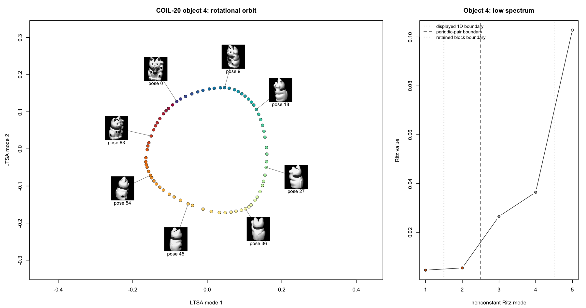
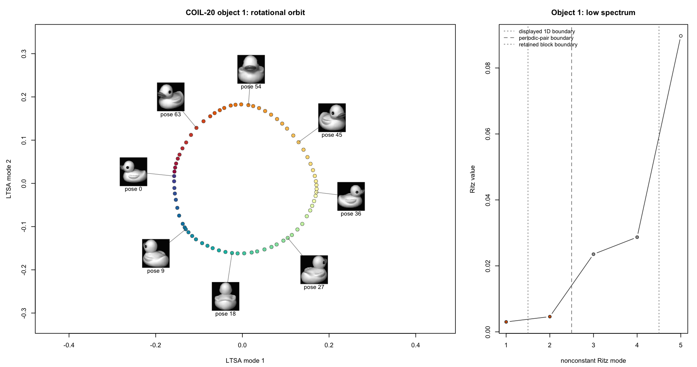
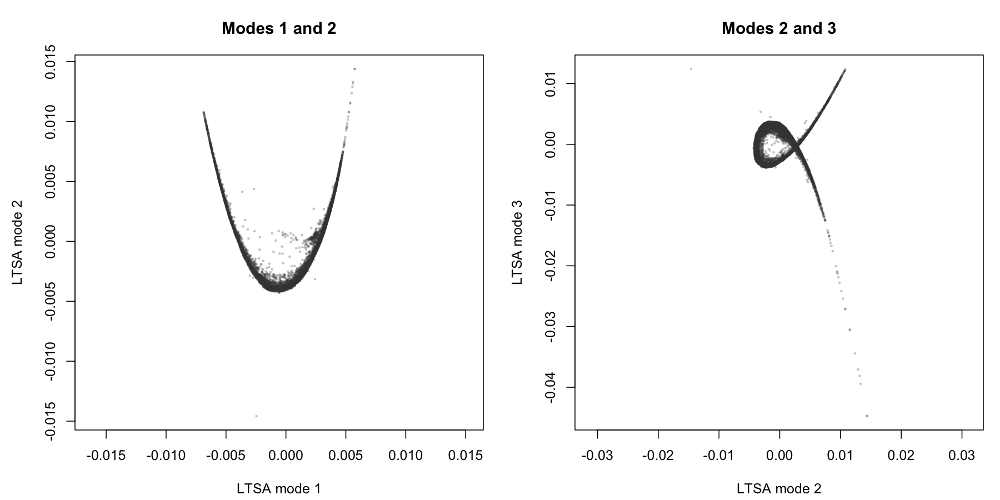
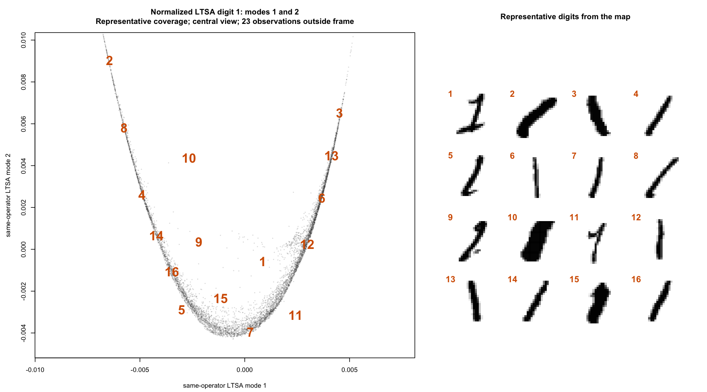
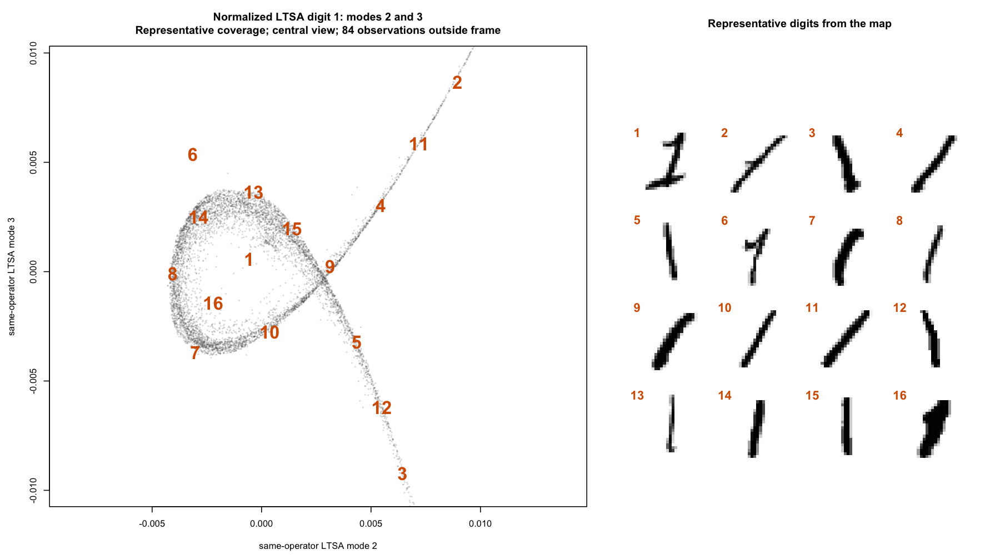
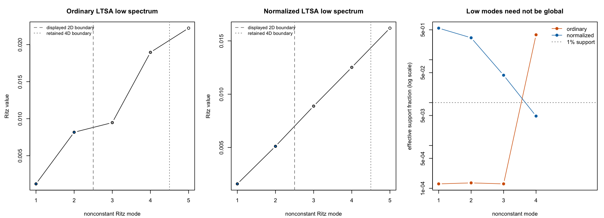
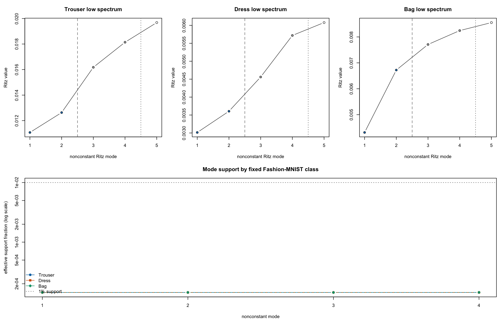

```{r setup, include=FALSE}
knitr::opts_chunk$set(
  collapse = TRUE,
  comment = "#>",
  fig.align = "center",
  fig.width = 11,
  fig.height = 7,
  dev.args = list(bg = "white")
)
library(flotsam)
```

LTSA uses `ndim` twice: once to build the local tangent spaces and again to
choose how many global coordinates to return. Those choices can differ. A
circle is locally one-dimensional, for example, but two coordinates show its
closed path.

`spectral_dim` retains extra coordinates from the same LTSA operator. This
article shows how to inspect them on a circle, COIL-20, MNIST, and
Fashion-MNIST.

Click any figure to open a larger version; click the enlarged image or press
Escape to close it. Keyboard users can focus a figure and press Enter or Space.

## Keep More Modes from the Same Operator

Given a data matrix `X`, request four low-frequency modes while keeping a
two-dimensional local tangent model and a two-coordinate returned embedding:

```r
fit <- flotsam::ltsa(
  X,
  ndim = 2,
  n_neighbors = 15,
  output = "result",
  spectral_dim = 4
)

dim(fit$embedding)                    # n by 2
dim(fit$spectral_embedding)           # n by 4
identical(
  fit$embedding,
  fit$spectral_embedding[, 1:2, drop = FALSE]
)
```

| Control | Changes `B`? | Purpose |
|---|:---:|---|
| `ndim` | yes | Sets the local tangent rank and displayed prefix |
| `spectral_dim` | no | Retains extra nonconstant modes from the fixed operator |
| `eig_k` | no | Gives the eigensolver a numerical candidate span |

Most users can leave `eig_k` at its default. When retaining an expanded block,
a manual request must be at least `spectral_dim + 2`: one place for the known
constant direction and another for the mode just beyond the retained block.

The displayed and retained boundaries have separate diagnostics:

```r
fit$eigen$diagnostics$scaled_boundary_gap
fit$eigen$spectral$diagnostics$scaled_boundary_gap
fit$eigen$status
fit$eigen$spectral$status
```

A boundary gap compares the last included mode with the next one. A large gap
isolates the chosen subspace. A small gap suggests interpreting the neighboring
modes together and checking their geometry and support.

## A Circle Needs a Spectral Pair

A circle has a one-dimensional tangent at every point. A single real-valued
coordinate cannot follow the whole loop continuously, so the first two
low-frequency modes work as a pair. Their signs and orientation can change
between fits; treat the two-dimensional span as the stable unit.

The example uses exact neighbors and dense eigenanalysis, making the repeated
pairs easy to see.

```{r circle-fit}
library(flotsam)
theta <- seq(0, 2 * pi, length.out = 721)[-721]
circle <- cbind(x = cos(theta), y = sin(theta))

circle_fit <- ltsa(
  circle,
  ndim = 1,
  n_neighbors = 9,
  nn_method = "exact",
  eig_method = "eig",
  eig_k = 8,
  output = "result",
  spectral_dim = 4
)

circle_fit$eigen$values
circle_fit$eigen$spectral$values
circle_fit$eigen$status
circle_fit$eigen$messages
```

```{r circle-witnesses, include=FALSE}
circle_pair <- circle_fit$spectral_embedding[, 1:2, drop = FALSE]
circle_pair_basis <- qr.Q(qr(circle_pair))
circle_target <- scale(circle, center = TRUE, scale = FALSE)
circle_target_residual <- circle_target -
  circle_pair_basis %*% crossprod(circle_pair_basis, circle_target)
circle_pair_gaps <- diff(circle_fit$eigen$ritz_values[1:3])

stopifnot(
  identical(
    circle_fit$embedding,
    circle_fit$spectral_embedding[, 1, drop = FALSE]
  ),
  sqrt(sum(circle_target_residual^2) / sum(circle_target^2)) < 1e-8,
  circle_pair_gaps[[2L]] > 100 * circle_pair_gaps[[1L]],
  circle_fit$eigen$status != "invalid",
  circle_fit$eigen$spectral$status != "invalid",
  circle_fit$assembly$component_count == 1L,
  circle_fit$assembly$rank_deficient_count == 0L,
  circle_fit$assembly$min_local_rank == 1L
)
```

```{r circle-figure, echo=FALSE, fig.cap="The input circle, its one-dimensional LTSA display, the first two modes from the same operator, and the low spectrum. The mode pair follows the complete periodic progression."}
circle_colors <- grDevices::hcl.colors(
  nrow(circle),
  # A cyclic palette makes the start and end of theta meet in color.
  palette = "Dynamic",
  rev = TRUE
)
circle_values <- circle_fit$eigen$ritz_values[1:5]

old_par <- graphics::par(no.readonly = TRUE)
graphics::par(mfrow = c(2, 2), mar = c(4, 4, 3, 1))

graphics::plot(
  circle,
  col = circle_colors,
  pch = 16,
  cex = 0.55,
  asp = 1,
  xlab = "input coordinate 1",
  ylab = "input coordinate 2",
  main = "Input circle"
)
graphics::plot(
  theta,
  circle_fit$embedding[, 1],
  col = circle_colors,
  pch = 16,
  cex = 0.55,
  xlab = "latent angle",
  ylab = "returned LTSA coordinate",
  main = "One displayed coordinate"
)
graphics::plot(
  circle_fit$spectral_embedding[, 1:2],
  col = circle_colors,
  pch = 16,
  cex = 0.55,
  asp = 1,
  xlab = "LTSA mode 1",
  ylab = "LTSA mode 2",
  main = "The first spectral pair"
)
graphics::plot(
  seq_along(circle_values),
  circle_values,
  type = "b",
  pch = 21,
  bg = c("#D55E00", "#D55E00", rep("grey80", 3)),
  xaxt = "n",
  xlab = "nonconstant Ritz mode",
  ylab = "Ritz value",
  main = "Low spectrum"
)
graphics::axis(1, at = seq_along(circle_values))
graphics::abline(
  v = c(1.5, 2.5, 4.5),
  lty = c(3, 2, 3),
  col = "grey40"
)
graphics::legend(
  "topleft",
  legend = c("displayed 1D", "first pair", "retained 4D"),
  lty = c(3, 2, 3),
  col = "grey40",
  bty = "n",
  cex = 0.75
)
graphics::par(old_par)
```

Setting `ndim = 2` would build a two-dimensional local tangent model. This fit
instead keeps `ndim = 1` and uses `spectral_dim = 4`: the first two retained
modes reveal the global coordinate pair, while the next two expose its
neighboring spectral context.

## COIL-20: A Real Periodic Example

[COIL-20](https://cave.cs.columbia.edu/repository/COIL-20) contains 72 views of
each object as it rotates. One object traces a closed, locally one-dimensional
curve through pixel space, so the circle example predicts a spectral pair.

At `k = 7`, mixing objects produces a disconnected neighbor graph, so we fit
objects separately. Objects 4 and 1 were selected before embedding using a
screen for connected graphs and good coverage of the pose sequence. Each fit
uses standard LTSA with `ndim = 1`, exact neighbors, and four retained modes.
The coordinates come from pixels; pose supplies the point colors and thumbnail
labels.





For objects 4 and 1, the gap after mode 2 is about 23 and 12 times larger,
respectively, than the gap between modes 1 and 2. This is the spectral pattern
expected from a mode pair. The second mode completes the rotational orbit
already present in the fixed operator.

## Check Whether a Mode Represents Many Observations

A low-energy mode can be dominated by a few observations. For a
Euclidean-normalized coordinate vector `v`, the effective support fraction is

$$
\frac{1}{n\sum_i v_i^4}.
$$

This is the normalized participation ratio. It equals $1/n$ when one
observation carries the mode, $r/n$ when the energy is spread equally across
exactly $r$ observations, and 1 when it is spread equally across all
observations. Here, a mode's energy means its squared coordinate values, `v^2`:

```r
effective_support_fraction <- function(v) {
  v <- v / sqrt(sum(v^2))
  1 / (length(v) * sum(v^4))
}
```

This scalar shows whether a coordinate is carried by many observations or only
a few. The plots then reveal the variation organized by a broadly supported
coordinate.

For a block of linearly independent coordinates, first orthonormalize its
columns. Each observation's **block leverage** is the sum of its squared
entries across that basis. Divide those leverages by their sum to get
influence fractions `p`, then compute `1 / (n * sum(p^2))`:

```{r block-support}
block_support_fraction <- function(V) {
  Q <- qr.Q(qr(V))
  p <- rowSums(Q^2) / ncol(Q)
  1 / (nrow(Q) * sum(p^2))
}
```

This block support is unchanged by rotating or rescaling coordinates within
the span. It does not establish where the span should end, so read it together
with the boundary gap.

## MNIST: Inspect a Neighboring Pair

The 7,877 MNIST digit-1 images illustrate what an extra coordinate can add to
an existing display. Here we use Jacobi-normalized LTSA, with `ndim = 2`,
`k = 15`, and four retained modes. The question is what to show from that
fixed operator. The [normalization article](ltsa-normalization.html) examines
the separate decision to change the estimator.

The first pair forms a curved band; replacing mode 1 with mode 3 gives a
loop with two branches. These plots show the full coordinate ranges, including
the more distant points. Each panel has its own axes, with equal physical
units on both axes.



The first pair arranges handwriting by slant, curvature, stroke width, hooks,
and serifed or branched forms. Its block support is `0.480`, with a mode 2--3
boundary gap of `0.00201`. To see the handwriting behind the shapes, expand
the central views. Numbered thumbnails are chosen to cover that region; the
plot titles report how many observations fall outside each frame.

<details>
<summary>MNIST: Modes 1 and 2 with Image Thumbnails</summary>



</details>

<details>
<summary>MNIST: Modes 2 and 3 with Image Thumbnails</summary>



</details>

Mode 3 is less broadly supported than modes 1 and 2. Across all four retained
modes, block support falls to `0.0497`, with a mode 4--5 gap of `0.00196`.
The additional coordinates therefore deserve more care than the first pair.
Keeping them makes the complementary view available; it does not mean all
four coordinates are equally useful.



## Fashion-MNIST: Extra Modes Can Stay Concentrated

Trousers, dresses, and bags provide a different reason to inspect a block:
we want to know whether concentration is confined to the first two modes.
Each class contains 7,000 images and uses one fixed approximate-neighbor
graph. We fit standard LTSA with `ndim = 2`, `k = 15`, and twelve retained
modes.

In all three first-pair displays, block support is close to the two-point
benchmark `2 / 7000`. The largest 1% of observations carry more than 99.98%
of the displayed span's leverage.


The source images identify those extreme points as atypical striped or noisy
records. They set the visible scale, while most garments are compressed
together. The graphs are connected, the local patches have full rank, and
the eigensolves converge, so we also inspect the extra modes.



All 36 coordinates across the three classes remain near the single-point
support limit, `1 / 7000`. The twelve-coordinate block supports are also close
to the corresponding `12 / 7000` benchmark.

For these fits, looking farther into the computed block does not reveal a
broadly supported coordinate. The mode 12--13 gaps are weak, so this
conclusion stops at the twelve modes inspected. To investigate changing the
weighting of the estimator itself, see
[Jacobi-Normalized LTSA](ltsa-normalization.html).

## What to Carry into Practice

Use `spectral_dim` when topology or a weak boundary gives you a reason to
look beyond the displayed coordinates. On the circle and COIL-20, a pair of
modes completes a closed path. MNIST supplies a useful neighboring view, with
less support in the added coordinate. Fashion-MNIST shows that a larger
computed block can remain concentrated throughout.

Read the plots together with support and boundary gaps, after checking graph,
rank, and solver diagnostics. [Diagnosing suspicious LTSA results](numerical-diagnostics.html)
gives the returned fields and the action associated with each signal.

Retaining a block supplies candidate coordinates; choosing which coordinates
to display is a separate problem. [Independent Eigencoordinate
Selection](https://proceedings.neurips.cc/paper_files/paper/2019/file/6a10bbd480e4c5573d8f3af73ae0454b-Paper.pdf)
is one published method for selecting smooth, locally independent coordinates
from a larger spectral set. `spectral_dim` does not perform that selection; it
exposes the candidate modes needed to investigate it.

## Trying It Yourself

Here's a compact version of the COIL-20 example. Install `flotsam`, `snedata`,
`vizier` 0.6.2 or later, and `ggplot2`:

```{r install-coil, eval=FALSE}
install.packages("pak")
pak::pak(c(
  "jlmelville/flotsam", "jlmelville/snedata", "jlmelville/vizier", "ggplot2"
))
```

Download object 4 and retain four coordinates from the one-dimensional local
model. The pose values are used only to color the plot.

```{r coil-example, eval=FALSE}
coil <- snedata::download_coil20(as = "list")
rows <- coil$meta$object == 4L
X <- coil$data[rows, , drop = FALSE]
pose <- as.integer(as.character(coil$meta$pose[rows]))

fit <- flotsam::ltsa(
  X, ndim = 1, n_neighbors = 7, nn_method = "exact", eig_method = "eig",
  eig_k = 8, output = "result", spectral_dim = 4
)
vizier::embed_ggplot(
  fit$spectral_embedding[, 1:2], pose,
  color_scheme = grDevices::hcl.colors(256, "Dynamic"), num_colors = 256,
  fixed_aspect = TRUE, title = "COIL-20 object 4: modes 1 and 2"
)
```

Try `fit$spectral_embedding[, 2:3]` to inspect the next pair. The article
figures add thumbnails of the object; this example plots the coordinates and
pose colors.

## Data Sources

The image examples use [COIL-20](https://cave.cs.columbia.edu/repository/COIL-20)
(Sameer A. Nene, Shree K. Nayar, and Hiroshi Murase),
[MNIST](http://yann.lecun.com/exdb/mnist/) (Yann LeCun, Corinna Cortes, and
Christopher J. C. Burges), and
[Fashion-MNIST](https://arxiv.org/abs/1708.07747) (Han Xiao, Kashif Rasul, and
Roland Vollgraf).
